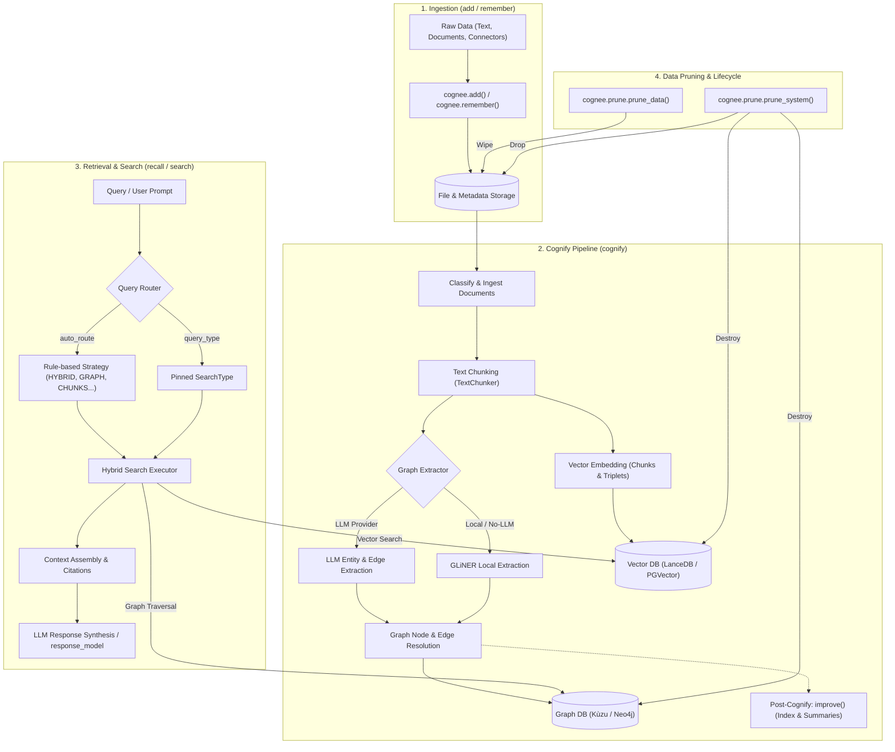
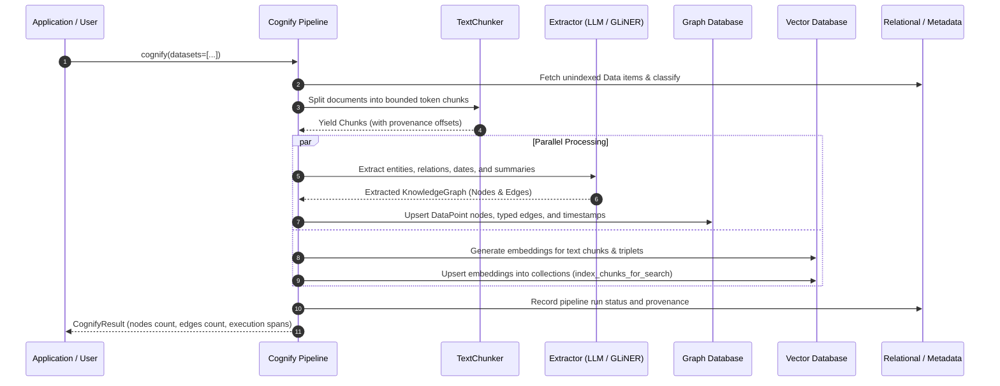
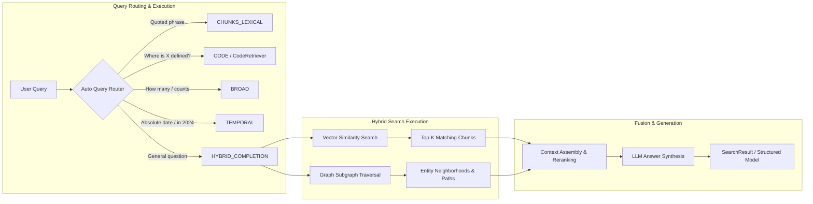

# Cognify and Search Lifecycle Architecture

This document provides visual pipeline flowcharts and a technical reference for Cognee's end-to-end memory lifecycle: how raw input transitions into knowledge graph structures and vector embeddings during `cognify()`, how hybrid retrieval traverses both during `search()` / `recall()`, and how pruning methods (`prune_data()`, `prune_system()`) manage data lifecycle and cleanup.

Source of truth:
- Cognify: `cognee/api/v1/cognify/cognify.py`
- Search & Recall: `cognee/api/v1/search/search.py` and `cognee/api/v1/recall/recall.py`
- Prune & Deletion: `cognee/modules/data/deletion/`

---

## 1. End-to-End Pipeline Overview



---

## 2. Ingestion & Cognify Lifecycle

`cognify()` transforms raw documents into two synchronized representations: a **Knowledge Graph** (entities, relationships, and attributes) and **Vector Indices** (dense chunk embeddings and triplet embeddings).



### Key Stages in Cognify

1. **Document Classification & Chunking:**
   - Unprocessed documents from `cognee.add()` are classified by MIME type.
   - `TextChunker` breaks text into chunks sized according to model limits and configured overlap parameters.
2. **Entity & Relation Extraction:**
   - Either through configured LLMs (structured output prompt) or local zero-shot NER models (GLiNER).
   - Resolves canonical names and merges identities across chunks.
   - Extracts explicit temporal markers as `Timestamp` nodes for temporal reasoning.
3. **Dual Persistence:**
   - **Graph Store:** Nodes (entities, concepts) and Edges (relations) are written to Kùzu, Neo4j, or configured graph backend.
   - **Vector Store:** Dense embeddings of raw chunks and graph triplets are stored in LanceDB, PGVector, or Turso.
4. **Enrichment (`improve()`):**
   - Optionally computes community summaries and populates dataset routing indexes.

---

## 3. Search and Retrieval Lifecycle

`recall()` (or low-level `search()`) executes hybrid retrieval across vector and graph storage to assemble comprehensive context.



### Retrieval Steps

1. **Query Routing:**
   - If `query_type` is omitted and `auto_route=True`, regex heuristics pick the best retrieval strategy without LLM cost.
2. **Dataset Routing:**
   - In multi-dataset setups, queries are matched against dataset routing index roots, avoiding full-database scans on unrelated memory.
3. **Hybrid Lookup:**
   - Vector search locates closest text chunks.
   - Graph engine traverses relationships connected to matching entity nodes.
4. **Context Fusion:**
   - Chunks, graph edges, and session memories are merged, formatted with citations, and handed to the completion model.

---

## 4. Data Lifecycle and Pruning APIs

Cognee provides distinct pruning methods depending on the required level of data deletion.

> [!WARNING]
> Pruning operations permanently remove data and cannot be undone. Always ensure necessary backups exist before invoking system-wide pruning methods.

### Comparison of Deletion Methods

| Method | Scope | Affected Stores | Use Case |
|---|---|---|---|
| `cognee.forget(dataset=..., document=...)` | Document or Dataset | Graph nodes, vector chunks, metadata | Safe user/session data removal |
| `cognee.prune.prune_data()` | Raw data files & caches | File storage root, cache engines | Free up disk space without destroying graph memory |
| `cognee.prune.prune_system()` | Entire system | Graph DB, Vector DB, Relational DB, Caches | Complete development / testing environment reset |

### Programmatic Pruning Examples

#### 1. Prune Data Storage
Removes uploaded raw files and clears memory caches, leaving the indexed knowledge graph and vector stores intact:

```python
import cognee

# Clear uploaded file assets and storage caches
await cognee.prune.prune_data()
```

#### 2. Prune System (Destructive Reset)
Wipes all graph databases, vector collections, relational tables, and cached data:

```python
import cognee

# Complete wipe of all cognee storage engines
await cognee.prune.prune_system(
    graph=True,
    vector=True,
    metadata=True,
    cache=True,
)
```

### CLI Data Lifecycle Commands

Cognee CLI exposes pruning and deletion operations from the terminal:

```bash
# Forget all memory across all datasets
cognee-cli forget --all

# Forget a specific dataset
cognee-cli forget -d my_dataset

# Inspect dataset and memory status
cognee-cli datasets list
```
