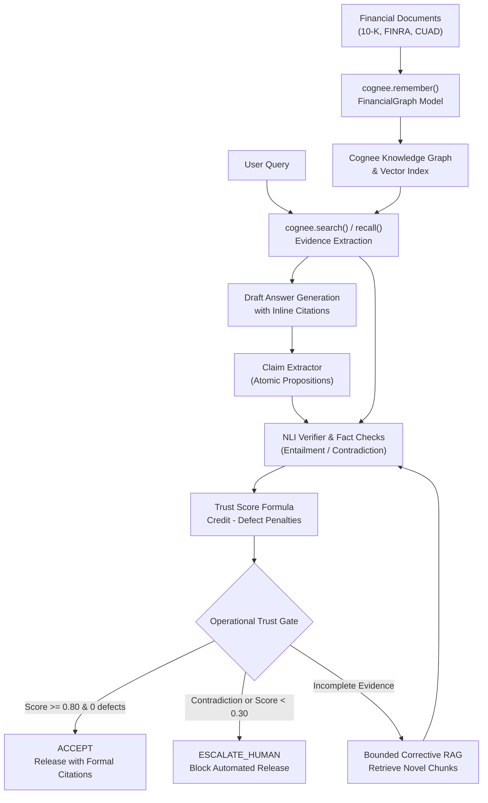

# TrustRAG: Verifiable Financial Document Intelligence on Cognee

A production-grade financial document intelligence workflow built on **Cognee**. Ingests complex financial documents (regulatory notices, credit agreements, 10-K filings), extracts a domain-specific financial knowledge graph, and provides verifiable question answering backed by **atomic claim decomposition**, **cross-encoder natural language inference (NLI)**, **deterministic fact-checks**, and **operational trust gating**.

Cognee serves as the central knowledge engine (ingestion, graph construction, vector/graph search), while the TrustRAG layer provides strict mathematical trust gating, verbatim citation attribution, and bounded corrective retrieval.



---

## What It Needs

| Requirement | Purpose | Configuration |
|---|---|---|
| `LLM_API_KEY` | Cognification, graph extraction, and answer synthesis | `.env` at repo root or environment variable |
| `sentence-transformers` | Cross-encoder NLI verification (`nli-deberta-v3-large`) | Optional (falls back automatically to deterministic `MockNLIBackend` for tests) |
| Python 3.10+ | Runtime environment | Managed via `uv` or standard virtual environment |

---

## Try It on Synthetic Financial Data

The cookbook includes a synthetic sample generator in `setup.py` that writes three realistic, non-confidential documents to `sample/` (git-ignored):
- **`Regulatory-Notice-24-99-synthetic.txt`**: Synthetic FINRA notice specifying algorithmic trading supervisory controls, a 35% liquidity shock parameter, and a $10,000,000 pre-trade risk threshold.
- **`Master-Services-Agreement-synthetic.txt`**: Synthetic CUAD commercial contract specifying a 36-month term, 90-day termination for convenience, and a $5,000,000 limitation of liability.
- **`Acme-Financial-10K-synthetic.txt`**: Synthetic EDGAR Form 10-K excerpt reporting $450,000,000 revenue (18.5% growth), $62,500,000 net income, and $128,400,000 cash reserves.

Run the end-to-end cookbook on the sample data:

```bash
uv run python examples/cookbooks/trustrag/trustrag.py
```

### Example Run Output

```text
[setup] Clearing dataset 'trustrag' before ingestion...
[clear] Successfully forgotten dataset 'trustrag'.
[ingest] Found 3 document(s) for ingestion.
[ingest] Ingesting Regulatory-Notice-24-99-synthetic.txt into dataset 'trustrag'...
[ingest] Ingesting Master-Services-Agreement-synthetic.txt into dataset 'trustrag'...
[ingest] Ingesting Acme-Financial-10K-synthetic.txt into dataset 'trustrag'...

[ask] Query: What are the annual stress testing parameters under Regulatory Notice 24-99, and what was Acme Financial's total revenue in fiscal year 2024?
[ask] Retrieving from dataset 'trustrag' and verifying claims...

======================================================================
VERIFIED ANSWER:
======================================================================
Under Regulatory Notice 24-99, member firms deploying algorithmic execution models must conduct annual stress testing with a minimum simulated liquidity shock parameter of 35% [Doc: Regulatory-Notice-24-99-synthetic, Section: Operational Requirements, Chunk: finra_c01]. Acme Financial Technologies reported consolidated total revenue of $450,000,000 for fiscal year 2024, representing an 18.5% increase year-over-year [Doc: Acme-Financial-10K-synthetic, Section: Financial Highlights, Chunk: edgar_c01].
======================================================================

Operational Gate Decision: ACCEPT
Composite Trust Score:     0.9450 (Accept >= 0.80, Escalate < 0.30)
Total Evaluated Claims:    2
  - Verified (Entailed):   2
  - Contradicted:          0
  - Neutral / Unproven:    0
  - Unsupported / Uncited: 0
```

---

## Run It on Your Financial Documents

Point the cookbook at a folder of your own filings, contracts, or regulatory notices:

```bash
# Check prerequisites
uv run python examples/cookbooks/trustrag/trustrag.py --check

# Ingest and query your documents
uv run python examples/cookbooks/trustrag/trustrag.py \
    --docs /path/to/filings \
    --ask "What is the aggregate liability ceiling under Section 11 of the agreement?"
```

Each step can also be run independently via individual CLI scripts:

```bash
# Ingest documents into Cognee
uv run python examples/cookbooks/trustrag/scripts/ingest.py --docs /path/to/filings

# Query the verified knowledge base
uv run python examples/cookbooks/trustrag/scripts/ask.py "What were the fiscal year 2024 revenues?"

# Prune or forget the dataset
uv run python examples/cookbooks/trustrag/scripts/clear.py --yes
```

---

## Core Verification Architecture

### 1. Financial Graph Model (`models.py`)
Extracts typed domain entities into Cognee's graph layer:
- `Organization`: Companies, regulatory bodies, issuers, service providers.
- `Person`: Executives, compliance officers, designated principals.
- `RegulatoryFiling`: 10-K, 10-Q, 8-K filings with reporting periods.
- `Regulation`: FINRA, SEC, and statutory rules with regulatory citations.
- `FinancialInstrument`: Equities, bonds, credit facilities, margin balances.

### 2. Evidence Normalization (`core/evidence.py`)
Converts Cognee's heterogeneous search outputs (`SearchResultPayload`, `CognifyResult`, `dlt` documents) into normalized `VerifiableEvidence` records with persistent source provenance (`chunk_id`, `doc_name`, `section`, `page`, `score`).

### 3. Atomic Proposition Extraction (`core/claims.py`)
Decomposes answers into isolated, verifiable factual assertions while strictly preserving inline citation tags (`[chunk_id]` and `[chunk_id | quote: "..."]`). Enforces citation invariants so hallucinated citation tags are caught before verification.

### 4. Natural Language Inference & Deterministic Fact Checks (`core/verification.py`, `core/fact_checks.py`)
- Directional 3-class NLI (`entailment`, `neutral`, `contradiction`) using cross-encoder architectures.
- High-precision deterministic checks for financial entities:
  - **Currency / Number alignment**: Catches magnitude hallucinations (e.g. `$5,000,000` vs `$50,000,000`).
  - **Percentages & Basis Points**: Confirms growth rates and margins.
  - **Temporal & Date verification**: Prevents misattribution across reporting periods.
  - **Modal / Obligation modifiers**: Distinguishes `shall` / `must` from `may` / `optional`.

### 5. Composite Trust Scoring & 3-Way Gate (`core/trust_score.py`)
Calculates an answer-level composite scalar $T \in [0.0, 1.0]$:

$$\text{RawScore} = \text{VerifiedCredit} - \left(\omega_{\text{contra}} \frac{N_{\text{contra}}}{N} + \omega_{\text{unsup}} \frac{N_{\text{unsup}}}{N} + \omega_{\text{neutral}} \frac{N_{\text{neutral}}}{N}\right)$$

Where:
- $\text{VerifiedCredit} = \frac{\sum_{i \in \text{Verified}} P(\text{entail}_i)}{N}$
- Penalties: $\omega_{\text{contra}} = 0.60$, $\omega_{\text{unsup}} = 0.30$, $\omega_{\text{neutral}} = 0.15$.
- **Contradiction Safety Ceiling**: If $N_{\text{contra}} > 0$, then $T \le 0.20$ regardless of other entailed claims.
- **Operational Gate Decisions**:
  - `ACCEPT`: Released with formal multi-chunk citation pointers ($T \ge 0.80$, 0 contradictions, 0 unsupported, 0 neutral).
  - `RE_RETRIEVE`: Routed to bounded corrective retrieval ($T \ge 0.30$, 0 contradictions, unverified claims present).
  - `ESCALATE_HUMAN`: Automated release blocked; contradiction or low-trust audit diagnostic logged.

### 6. Bounded Corrective RAG (`core/corrective.py`)
When routed to `RE_RETRIEVE`:
- Derives pinpoint search queries directly from unverified atomic propositions.
- Queries Cognee with overfetch to discover novel chunks not previously evaluated.
- Re-verifies unverified claims against novel and accumulated evidence.
- Preserves untouched claims and claim ordering while updating the composite trust report.
- Strictly bounded by `max_hops <= 2` to prevent unbounded query loops.

---

## Cookbook Structure

```text
examples/cookbooks/trustrag/
├── README.md              # This documentation
├── trustrag.py            # Primary CLI entry point (--check, --sample, --docs, --ask)
├── setup.py               # Generates synthetic sample financial filings
├── models.py              # Financial graph schema (Organization, Regulation, etc.)
├── config.py              # Runtime configuration & environment defaults
├── sample/                # Synthetic financial documents (git-ignored)
├── core/
│   ├── evidence.py        # Cognee search adapter & VerifiableEvidence contract
│   ├── claims.py          # Atomic claim decomposition & citation invariant
│   ├── verification.py    # Cross-encoder NLI backend & MockNLI verifier
│   ├── fact_checks.py     # Deterministic currency, percentage, and date checks
│   ├── quote_validator.py # Verbatim quote grounding and elision validation
│   ├── sentence_window.py # Sentence-window localized premise verification
│   ├── relevance.py       # Answer relevance evaluation & refusal detection
│   ├── llm_judge.py       # LLM judge tiebreaker for ambiguous neutral claims
│   ├── trust_score.py     # Mathematical trust scoring & 3-way operational gating
│   ├── corrective.py      # Bounded corrective retrieval & claim re-verification
│   └── answer.py          # End-to-end verified answer orchestrator
├── scripts/
│   ├── ingest.py          # Document ingestion CLI with error propagation
│   ├── ask.py             # Verified question answering CLI
│   └── clear.py           # Explicit dataset pruning CLI
└── tests/
    ├── test_claims.py
    ├── test_corrective.py
    ├── test_evidence_adapter.py
    ├── test_fact_checks.py
    ├── test_trust_score.py
    ├── test_verification.py
    └── test_end_to_end.py
```

---

## Testing

Run the offline test suite:

```bash
pytest examples/cookbooks/trustrag/tests/
```

All 35 tests run completely offline in under a second using deterministic mock backends without downloading model weights or making external API calls.

