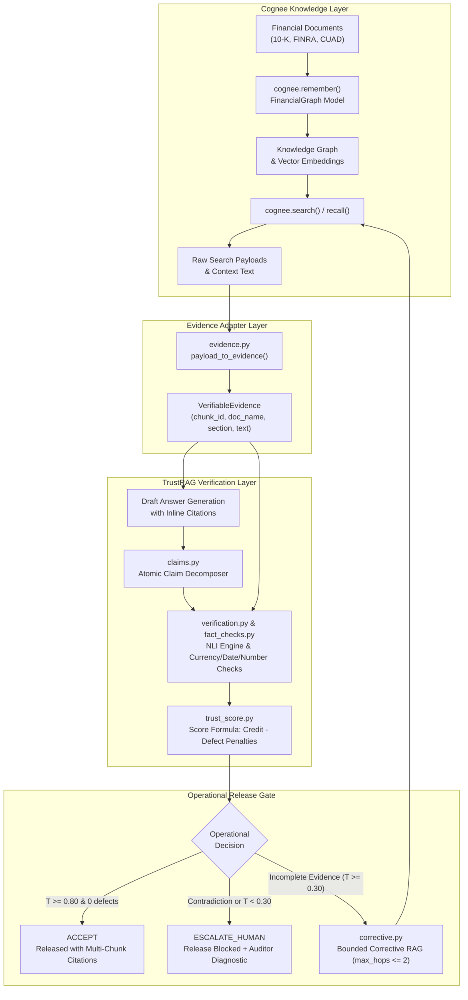

# Walkthrough: TrustRAG Financial Intelligence Cookbook on Cognee

This document provides a walkthrough of the **TrustRAG Cookbook** implemented inside **Cognee** (`examples/cookbooks/trustrag/`) on branch `feature/trustrag-standalone`.

---

## 1. Executive Summary & Objective

**TrustRAG** brings production-grade financial document verification and trust gating to Cognee:
- **Cognee** operates as the core knowledge engine: document ingestion, domain knowledge graph extraction (`FinancialGraph`), vector storage, and search.
- **TrustRAG** operates as the verification and governance layer: atomic claim decomposition, directional cross-encoder Natural Language Inference (NLI), deterministic fact-checking, mathematical trust scoring, operational gating, and bounded corrective retrieval.



---

## 2. Component Walkthrough

### 2.1 Configuration & Domain Schema
- [`config.py`](config.py): Lightweight configuration using environment variables with defaults (`TRUSTRAG_DATASET="trustrag"`, `TRUSTRAG_ENTAILMENT_THRESHOLD=0.60`, `TRUSTRAG_CONTRADICTION_THRESHOLD=0.50`, `TRUSTRAG_TRUST_ACCEPT=0.80`, `TRUSTRAG_TRUST_ESCALATE=0.30`, `TRUSTRAG_MAX_HOPS=1`).
- [`models.py`](models.py): Financial domain ontology defining `Organization`, `Person`, `RegulatoryFiling`, `Regulation`, and `FinancialInstrument` as Cognee `DataPoint`s, unified in `FinancialGraph`. Includes `EXTRACTION_PROMPT` tailored for SEC, FINRA, and commercial contract entities.

### 2.2 Evidence Normalization & Retrieval Adapter
- [`core/evidence.py`](core/evidence.py):
  - `VerifiableEvidence`: Pydantic data contract preserving `chunk_id`, `text`, `doc_name`, `section`, `page`, `score`, and `metadata`.
  - `payload_to_evidence()`: Resolves heterogeneous Cognee search returns (`SearchResultPayload`, `CognifyResult`, `dlt` documents, raw dictionaries) into deduplicated `VerifiableEvidence` objects.
  - `search_cognee()` / `search_cognee_sync()`: Async and sync interfaces querying Cognee using configurable search types (`GRAPH_COMPLETION`, `CHUNKS`, `SUMMARIES`).

### 2.3 Proposition Decomposition & Citation Integrity
- [`core/claims.py`](core/claims.py):
  - `extract_claims()`: Decomposes draft answers into atomic propositions.
  - **Citation Invariant**: Ensures citations (`[chunk_id]`) map strictly to citations present in the draft answer; any hallucinated citations by an LLM trigger a fallback to the rule-based extractor.
  - Filters out faithful refusal phrases (e.g., *"The provided evidence does not contain sufficient information..."*) so refusals are not penalized as unproven assertions.

### 2.4 Factual Verification & High-Precision Deterministic Checks
- [`core/verification.py`](core/verification.py):
  - `NLIBackend` abstraction with `CrossEncoderNLIBackend` (`nli-deberta-v3-large` via sentence-transformers, lazy-loaded) and `MockNLIBackend` (offline deterministic verifier).
  - Evaluates individual chunk premises and concatenated joint multi-chunk premises.
  - **Contradiction Precedence**: Any high-confidence contradiction ($P(\text{contra}) \ge \tau_{\text{contra}}$) immediately flags the claim as `CONTRADICTION`.
- [`core/fact_checks.py`](core/fact_checks.py):
  - Deterministic entity validation: verifies currency amounts (`$5,000,000` vs `$50,000,000`), percentages (`18.5%`), basis points (`240 bps`), dates (`October 15, 2024`), numbers, and modal obligation words (`shall`, `must`, `may`).
  - In `enforce` mode, fact-check mismatches downgrade `ENTAILMENT` to `NEUTRAL`.
- [`core/quote_validator.py`](core/quote_validator.py):
  - Validates verbatim supporting quotes in `[chunk_id | quote: "..."]` citations. Supports exact substring matching, punctuation normalization, and linear-time elision matching (`"..."`).

### 2.5 Trust Scoring & Operational Gating
- [`core/trust_score.py`](core/trust_score.py):
  - Formulates answer-level trust score $T \in [0.0, 1.0]$:
    $$\text{RawScore} = \text{VerifiedCredit} - \left(0.60 \cdot \frac{N_{\text{contra}}}{N} + 0.30 \cdot \frac{N_{\text{unsup}}}{N} + 0.15 \cdot \frac{N_{\text{neutral}}}{N}\right)$$
  - **Contradiction Safety Ceiling**: If $N_{\text{contra}} > 0$, then $T \le 0.20$ regardless of other entailed claims.
  - **3-Way Operational Gate**:
    - `ACCEPT`: Released with formal multi-chunk citations (e.g. `[Doc: Notice_24-99, Section: Summary, Chunk: c1]`). Requires $T \ge 0.80$ and zero defects (0 contradiction, 0 unsupported, 0 neutral).
    - `RE_RETRIEVE`: Routed to bounded corrective retrieval when $T \ge 0.30$, 0 contradictions, but incomplete evidence exists.
    - `ESCALATE_HUMAN`: Release blocked; contradiction or low-trust audit logged.

### 2.6 Bounded Corrective Retrieval (CRAG)
- [`core/corrective.py`](core/corrective.py):
  - `formulate_claim_query()`: Extracts targeted search queries from unverified atomic propositions.
  - `CogneeCorrectiveBackend`: Queries Cognee with overfetch against already evaluated chunk IDs to discover novel evidence.
  - `reverify_claim()`: Re-evaluates targeted claims against novel and accumulated evidence, preserving joint premises.
  - `correct_and_reverify()`: Synchronizes the updated claims with untouched claims, preserving ordering and claim count. Strictly bounded by `max_hops <= 2`.

### 2.7 Pipeline Orchestration
- [`core/answer.py`](core/answer.py):
  - End-to-end entry points `ask_verified` (synchronous) and `ask_verified_async` (asynchronous).
  - Coordinates retrieval $\rightarrow$ draft generation $\rightarrow$ claim decomposition $\rightarrow$ verification $\rightarrow$ trust scoring $\rightarrow$ corrective retrieval $\rightarrow$ final answer assembly.

---

## 3. Operational Scenarios & Verifications

### Scenario 1: Clean Acceptance with Formal Citations
- **Input**: Query regarding FINRA liquidity shock parameter and Acme's 2024 revenue.
- **Evidence**: Chunk `finra_c01` ($35\%$ parameter) and Chunk `edgar_c01` ($\$450\text{M}$ revenue).
- **Verification**: Both claims evaluate to `ENTAILMENT` with $P(\text{entail}) \ge 0.94$.
- **Outcome**:
  - `Composite Trust Score`: $0.9500 \ge 0.80$
  - `Gate Decision`: `ACCEPT`
  - `Final Answer`: Released with inline attribution: `[Doc: Notice_24-99, Section: Operational Requirements, Chunk: finra_c01]` and `[Doc: Acme_10K, Section: Financial Highlights, Chunk: edgar_c01]`.

### Scenario 2: Contradiction Detection & Safety Ceiling
- **Input**: Query regarding Service Provider liability ceiling under Section 11.2.
- **Evidence**: Chunk stating liability is capped at $\$5,000,000$.
- **Draft Claim**: *"The liability cap under Section 11.2 is unlimited with no dollar ceiling."*
- **Verification**: Evaluated to `CONTRADICTION` ($P(\text{contra}) = 0.98$).
- **Outcome**:
  - `Composite Trust Score`: Clamped to $0.20$ by the Contradiction Safety Ceiling.
  - `Gate Decision`: `ESCALATE_HUMAN`
  - `Final Answer`: `[BLOCKED - ESCALATE TO HUMAN AUDITOR] Factual contradiction detected in 1 claim(s). Contradiction ceiling applied (T=0.200 <= 0.20).`

### Scenario 3: Bounded Corrective Retrieval (RE_RETRIEVE $\rightarrow$ ACCEPT)
- **Input**: Query requiring multiple specific parameters.
- **Initial Retrieval**: Surfaces evidence for Claim 1 (verified), but lacks evidence for Claim 2 (neutral).
- **Initial Gate**: $T = 0.40 \ge 0.30$, zero contradictions $\rightarrow$ `RE_RETRIEVE`.
- **Corrective Hop 1**:
  - Formulates targeted query from Claim 2.
  - Cognee search discovers novel chunk not previously evaluated.
  - Re-verification resolves Claim 2 to `ENTAILMENT`.
- **Final Outcome**:
  - `Resolved Claims`: $1 / 1$
  - `Updated Trust Score`: $0.9350 \ge 0.80$
  - `Updated Gate Decision`: `ACCEPT` (automated release succeeded after 1 hop).

### Scenario 4: Benchmark-Safe Refusal
- **Input**: Unanswerable question not present in the ingested corpus.
- **Draft Answer**: *"The provided evidence does not contain sufficient information to answer this question."*
- **Outcome**:
  - Identified as faithful refusal (`is_refusal=True`).
  - `Composite Trust Score`: $1.0000$
  - `Gate Decision`: `ACCEPT`
  - Evaluators can cleanly partition refusal accuracy from answer hallucinations.

---

## 4. CLI Usage Guide

### 4.1 Check Prerequisites
```bash
uv run python examples/cookbooks/trustrag/trustrag.py --check
```
Validates required environment variables (e.g., `LLM_API_KEY`) and paths. Exits with code `0` if ready, or `2` if prerequisites are missing.

### 4.2 Run on Synthetic Sample Data
```bash
uv run python examples/cookbooks/trustrag/trustrag.py
```
Automatically generates synthetic financial filings in `sample/`, clears the `trustrag` dataset, ingests the documents with `FinancialGraph`, and answers the default financial query.

### 4.3 Ingest User-Provided Documents
```bash
uv run python examples/cookbooks/trustrag/scripts/ingest.py --docs /path/to/filings --dataset my_financial_ds
```
Ingests documents with progress logging, document-level error propagation, and failure reporting.

### 4.4 Ask a Verified Question
```bash
uv run python examples/cookbooks/trustrag/scripts/ask.py "What was Acme's net income in 2024?" --dataset my_financial_ds --verbose
```

### 4.5 Prune or Clear a Dataset
```bash
uv run python examples/cookbooks/trustrag/scripts/clear.py --dataset my_financial_ds --yes
```

---

## 5. Test Suite Verification

The test suite runs completely offline without downloading model checkpoints or requiring API keys:

```bash
pytest examples/cookbooks/trustrag/tests/ -v
```

### Test Results Breakdown (35 Passed)
| Test Module | Coverage | Status |
|---|---|---|
| `test_evidence_adapter.py` | Payload normalization, deduplication, fallback context, text map | **5 PASSED** |
| `test_claims.py` | Proposition decomposition, citation extraction, refusal filtering, citation invariants | **5 PASSED** |
| `test_fact_checks.py` | Currency, percentage, date, and numeric deterministic checks | **8 PASSED** |
| `test_verification.py` | Uncited claims, unresolvable citations, entailment, contradiction, fact-check overrides | **5 PASSED** |
| `test_trust_score.py` | Multi-chunk citations, full acceptance, contradiction ceiling, refusal handling, RE_RETRIEVE | **5 PASSED** |
| `test_corrective.py` | Query formulation, claim re-verification, bounded hop loop, state preservation | **3 PASSED** |
| `test_end_to_end.py` | Synthetic generation, full end-to-end ACCEPT, contradiction escalation, corrective resolution | **4 PASSED** |
| **Total** | **Full offline verification across all modules** | **35 PASSED in 0.20s** |

---

## 6. Git & Safety Status

- **Source Repository (`C:\Users\Lenovo\Music\trustrag`)**: Working tree is 100% clean and untouched (`cogneerag` branch).
- **Other Branches in Cognee**: Branch `feat/evidence-reference-source-text-locators` is completely untouched.
- **Active Working Branch**: `feature/trustrag-standalone` in `C:\Users\Lenovo\Music\cognee`.
- **Changed Files**:
  - `examples/README.md` (catalog entry)
  - `examples/cookbooks/trustrag/` (all standalone cookbook files, tests, and walkthrough)
  - No commits or remote pushes have been made.

