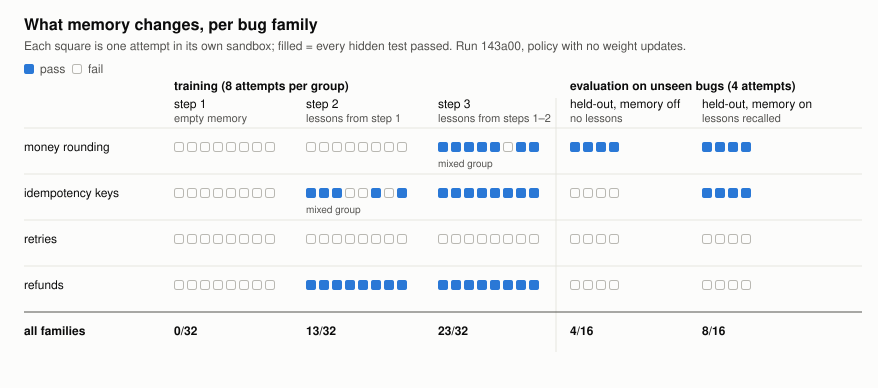

# RL rollouts on Daytona with cognee memory

The [HUD RL cookbook](https://www.daytona.io/docs/en/guides/reinforcement-learning/hud-rl-cookbook/)
runs one small coding task at scale: a task template with variants, a fresh
Daytona sandbox per attempt, pytest as the grader, a binary reward, groups of
attempts per variant for a group-relative trainer. Its sandboxes are
ephemeral by design and every attempt starts from the same seeded state;
nothing persists between episodes.

This example keeps the cookbook's shape and adds the part it leaves out:
**memory that persists across episodes**, in its own sandbox, learned from
rewards.

```
memory sandbox   cognee-rl-memory-<run>    cognee API server, lives for the whole run
rollout sandbox  cognee-rl-<variant>-<n>   1 vCPU / 1 GB, seeded bug + hidden tests, deleted after grading

for step in 1..3:
    for variant in one-per-family:
        lessons = memory.recall(family)                 # one recall per group
        group   = 8 attempts in fresh sandboxes:        # prompt (+ lessons) -> LLM -> write -> pytest
        memory.remember(each attempt, reward)           # scored QA entry in the step's session
    memory.improve(session_ids=[step])                  # attempts -> lessons for the next step
evaluate held-out variants, memory off then on
export the memory as a COGX archive                     # the checkpoint
```

## The environment

`ledger_env.py` is a tiny billing ledger (`ledger.py`) with thirteen hidden
tests. Twelve variants each seed one bug, in four families: money rounding,
idempotency keys, retries, refunds. The agent sees the buggy file, a short
README and the **names** of the failing tests, not the tests. The tests
enforce conventions the README does not state (money rounds half up, a
repeated idempotency key returns the original charge id, five attempts with
doubling delays, `LedgerError("over_refund")`), so an attempt learns them by
failing, and the failing assertions are what goes into memory. Variants in a
family share the convention, which is what lets a lesson transfer: from the
training variants to their siblings in the next step, and to the held-out
variant in evaluation.

The reward is binary, every hidden test passes or not. The cookbook tried
partial credit and found it flattened the within-group spread that a
group-relative trainer learns from; the same holds here.

## Where memory enters the loop

- **Memory sandbox.** One sandbox from the `cognee-memory` snapshot runs
  `python -m cognee.api.client` in single-user mode. It is private: the host
  reaches it through the Daytona preview URL and its token. The LLM key is the
  same host-scoped Secret the handover demo uses, so the sandbox holds a
  placeholder; cognee's own LLM calls go through Daytona's proxy.
- **Before a group:** one `POST /api/v1/recall` for the family ("which
  conventions do the hidden tests enforce, and what fixes passed?"). The answer
  is appended to the prompt of all attempts in the group.
- **After an attempt:** one `POST /api/v1/remember/entry` with a scored
  `QAEntry`: the task prompt, the returned file, the failing assertions, and
  `feedback_score` 5 for reward 1, 1 for reward 0, in the step's session.
- **After a step:** `POST /api/v1/improve` with the step's session id. The
  feedback-weights stage applies the scores and the scored attempts are
  persisted into the graph. The lesson-drafting stages are off in this setup
  (they hang on per-turn feedback analysis, which the memory server runs with
  `AUTO_FEEDBACK=false` to keep recalls to one LLM call); the lessons are
  synthesized at recall time, over the persisted attempts, by the recall's
  system prompt ("state the conventions the hidden tests enforce and the fixes
  that passed; quote exact expected values and messages; never return a code
  file"). Without that prompt a recall replays a stored answer, which for a
  failed attempt is a wrong `ledger.py`, and the next group inherits it.
- **At the end:** `cognee.export(format="cogx")` of the `rl_memory` dataset,
  pulled to `out/`. Restore it into a fresh memory sandbox with
  `cogx_handover.py import` to continue from this checkpoint, the way a weight
  checkpoint would be loaded.

## What the numbers mean

No gradient step runs here; that is the cookbook's hosted trainer, fed by the
graded rollouts. The run prints what memory changes for such a trainer:

- **Pass rate per step**, with memory accumulating between steps.
- **Learnable groups per step**: groups whose rewards are mixed. A group of
  all zeros or all ones is a zero-variance batch the trainer skips. Memory
  raises the pass rate, and when it lifts a group from all-fail to mixed it
  creates training signal; when it lifts one to all-pass it removes it. Both
  show up in the count.
- **Held-out, memory off against memory on**: the same unseen bugs with and
  without the lessons. That difference is what memory alone buys the policy.

## What a run looks like



Each square is one attempt in its own sandbox, filled when every hidden test
passed. Read it row by row: a family flips from all-fail to all-pass the step
after its failures were distilled; "mixed group" marks the groups a
group-relative trainer could learn from; the held-out columns are the same
unseen bugs without and with the lessons. `make_figure.py` draws it from a
run's report JSON.

Four full runs on a stock Tier 1/2 account (policy `openai/gpt-5.6-luna`,
3 steps, 4 variants, groups of 8, 4 sandboxes at a time; 128 rollouts, about
15 minutes, 17 s per attempt). `transcript.txt` is the last one.

| run | step 1 | step 2 | step 3 | held-out off | held-out on |
|---|---|---|---|---|---|
| 1 | 0/32 | 16/32 | 13/32 | 4/16 | 8/16 |
| 2 | 0/32 | 9/32 | 16/32 | (hung, see below) | |
| 3 | 0/32 | 24/32 | 24/32 | 3/16 | 8/16 |
| 4 (recorded) | 0/32 | 13/32 | 23/32 | 4/16 | 8/16 |

What is stable: step 1 is zero with an empty memory; one `improve()` later
whole families flip from 0/8 to 8/8 on sibling bugs; held-out doubles with
memory on. What varies: *which* families flip in a given step. The lessons
are synthesized by an LLM at recall time from the persisted attempts, so
two runs with the same failures can phrase them differently, and a lesson
that names the expected value but not the exact formula leaves a group at
0/8 for one more step. Retries and refunds are the slow families: their
hidden expectations (`LedgerError("retry_exhausted")` chained from the last
error, a full refund releasing the key) only show up in the failure output
once some attempt gets close, which in three steps happened in some runs and
not others.

Most groups are uniform, 0/8 or 8/8, which is the memory-and-trainer
interaction in the open: a policy this strong plus a precise lesson leaves a
group-relative trainer no spread. Mixed groups appeared where the lesson was
partial (B2 5/8, A1 7/8 in run 4). A weaker policy, or lessons held back
from a share of the group, would turn memory into a curriculum knob rather
than a solution; both are one-line changes here (`POLICY_MODEL`, the
`lessons` argument in `run_group`).

Run 2 hung in the evaluation: the Daytona SDK's exec stream dropped
("packet queue is empty") and a call with no deadline waited forever while
the idle rollout sandboxes auto-stopped. The loop now has a 120 s timeout on
the policy call, a 240 s deadline per attempt (a timed-out attempt counts as
reward 0 and is not written to memory), and a sweep of leftover rollout
sandboxes by label after every group.

## Run it

```console
$ pip install daytona httpx litellm
$ export DAYTONA_API_KEY=...
$ export LLM_API_KEY=sk-...                  # the policy runs on the host
$ python rl_loop.py                          # 3 steps x 4 variants x 8 attempts, eval, export
$ python rl_loop.py --steps 1 --group 2      # a quick one
$ python rl_loop.py --keep                   # keep the memory sandbox
$ python ../walkthrough.py --live --script rl_loop.py --record transcript.txt   # annotated
$ python ../walkthrough.py --transcript transcript.txt                           # replay it
```

Knobs: `--group` attempts per variant, `--parallel` rollout sandboxes at once
(default 4: the memory sandbox takes 4 GiB of a Tier 1/2 organization's 10 GiB
running quota, rollouts 1 GiB each), `--eval-attempts` per held-out variant,
`POLICY_MODEL`/`LLM_MODEL` for the policy. Every sandbox carries a
`run=<id>` label and is deleted at the end; `--keep` spares the memory sandbox.

Two snapshots: the handover demo's `cognee-memory` for the memory sandbox and
`cognee-rl-env` (Debian, Python 3.12, pytest; 1 vCPU, 1 GB, 3 GB) for the
rollouts, built on first use. Forks and warm pools are not used: forks need VM
sandboxes, and a fresh container is about three seconds here.

## Layout

```
rl/
├── rl_loop.py        # memory sandbox + rollout groups + improve + eval + COGX export
├── ledger_env.py     # the task: reference ledger, seeded variants, hidden tests, prompt, grader
├── make_figure.py    # reward grid (results.svg) from a run's report JSON
├── results.svg       # the recorded run's reward grid
├── transcript.txt    # the recorded run (replay with ../walkthrough.py --transcript)
├── WALKTHROUGH.md    # the same run as an annotated document
├── out/              # COGX checkpoint and per-run report JSON (created at runtime)
└── README.md
```
